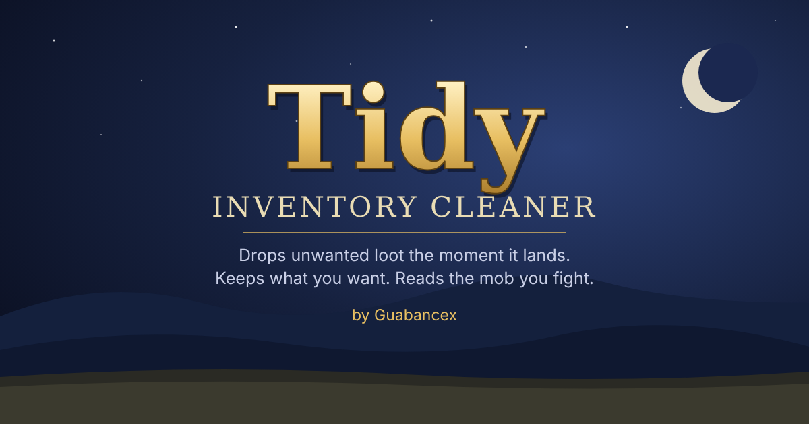
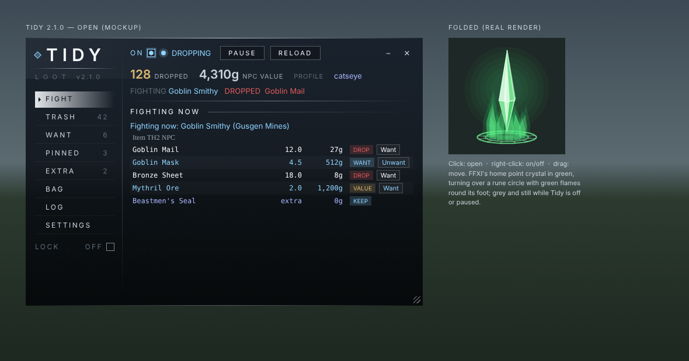

# Tidy

**Author:** Guabancex
**Version:** 2.1.0
**For:** Ashita v4 · CatsEyeXI (FFXI)

Tidy keeps your inventory clear while you play. When unwanted loot lands in your
bag, Tidy drops it right away. You decide what counts as unwanted. Tidy can also
read the monster you're fighting, look up its drop list in the CatsEyeXI
database, and drop anything from that list you don't need.

---

## Contents

- [Features](#features)
- [Installing](#installing)
- [Quick start](#quick-start)
- [How Tidy decides what to drop](#how-tidy-decides-what-to-drop)
- [The window](#the-window)
- [Commands](#commands)
- [Profiles](#profiles)
- [Hunt mode in detail](#hunt-mode-in-detail)
- [Safety](#safety)
- [Troubleshooting](#troubleshooting)
- [Updating the drop database](#updating-the-drop-database)
- [Files](#files)

---

## Features

- **Trash lists.** Name the items you never want. Tidy drops them on sight.
- **Hunt mode.** Tidy reads the mob you're fighting and drops the useless items
  from its drop list. You don't set anything up per mob.
- **Keep rules.** Items you mark **Want** are always kept, and so are
  **Rare/Ex** items and anything worth at least your **Keep value** in NPC gil.
- **Only new loot.** In Hunt mode, items you already had are never touched.
- **Extra drops.** Loot the server adds outside the drop lists (such as
  Ramuite) is learned from the treasure pool, and you choose whether Tidy keeps
  it or cleans it.
- **Profiles.** Keep separate trash lists and hunts for each camp, job or event.
- **A YunaUI-style window.** Pages in a sidebar. See the mob you're fighting and its drop table, press
  **Want** on an item mid-fight, search any list, and add items by typing part
  of their name.
- **Treasure Hunter rates.** Drop tables show each item's chance at your
  Treasure Hunter level, on CatsEyeXI's own TH scale.
- **Diagnostics.** `/tidy why` explains exactly why each item is or isn't
  dropped.

---

## Installing

> The version is shown in three places: the window title (**Tidy v2.1.0**), the
> chat line when Tidy loads, and `/tidy help`. Download files are named with the
> version too, for example `Tidy-v2.1.0.zip`.

1. Copy the `Tidy` folder into `Ashita/addons/`.
2. In game, type `/addon load tidy`.
3. To load it automatically, add `/addon load tidy` to your Ashita startup
   script (for example `scripts/default.txt`).

Tidy saves its settings per character and keeps them across reloads.

---

## Quick start

**Option A: drop specific junk**

1. Type `/tidy` to open the window.
2. On the **Bag** page, press **Trash** next to something you never want. Or, on
   the **Trash** page, type part of a name and click it. You can also type
   `/tidy add Bat Wing`.
3. Click the switch at the top of the window so it reads **DROPPING**, or type `/tidy on`.

**Option B: let Tidy read your fights**

1. Type `/tidy on`. Hunt's **Auto** setting is on by default.
2. Engage a monster. The **Fight** page shows **Fighting now: \<mob\>** with its
   drop table.
3. Press **Want** on the item you're farming.
4. Anything else that mob drops is dropped as it lands, unless it's Rare/Ex or
   worth at least your Keep value.

> **Tip:** Try it first on a cheap mob. Dropped items are gone for good.

---

## How Tidy decides what to drop

Tidy checks your main inventory about twice a second and drops one stack at a
time. For each item, the first rule that applies decides what happens:

| # | Rule | Result |
|---|------|--------|
| 1 | Gil, equipped items, bazaar items | **Never dropped** |
| 2 | Marked **Want** (Hunt) | **Kept** |
| 3 | On your **trash list** | **Dropped**, every copy |
| 4 | On the drop list of a mob you fought or pinned (or an **Extra drop** set to Rules), and **Rare/Ex** (with Keep Rare/Ex on) | **Kept** |
| 5 | Same, and worth at least **Keep value** NPC gil | **Kept** |
| 6 | Same, and none of the above | **Dropped**, new copies only |
| – | An **Extra drop** set to Keep | **Kept** |
| 7 | Anything else | **Kept** |

Items not on any list are always kept. Tidy never drops something just because
it's unfamiliar.

---

## The window

Type `/tidy` to show or hide it, or click **x** in its top corner to close it.
Click **-** to fold it down to FFXI's home point crystal in green (or type
`/tidy mini`): a tall shard that turns slowly and floats over a glowing rune
circle, with green flames flickering round its foot; it goes grey and still
while Tidy is off or paused. Hover it for Tidy's state, what it has dropped and
the mob you're fighting; click it to open the window, right-click it to turn
Tidy on or off, drag it to move it.
Tidy remembers whether it was folded.


The window is designed after Final Fantasy XV's menus: smoked blue-black glass
that shades to near black, with white hairlines along the top and bottom that
fade out at their ends; a **sidebar** on the left with **T I D Y** in spaced
white capitals after a small pale blue diamond, the version, and one row per
page; and the page on the right, past a faint dividing line. The open page sits
on FFXV's bright light band (fading to the right) in dark type with a chevron.
**Pale blue** means on / kept / wanted, a **muted red** marks what gets
dropped, **soft gold** is gil, and **periwinkle** marks places and extra drops.

Settings use **ON / OFF** toggles with a square check box and hairline
**sliders** with a white diamond knob; section names are in spaced capitals
with a hairline that fades out; buttons are square key caps with a hairline
frame (pale blue for the main action) that light up under the mouse; and
tooltips are dark glass cards with a pale blue line along the top.

**Lock:** the **Lock** switch at the bottom of the sidebar pins the window and
the folded green crystal where they are, so a stray drag can't move them. Flip it
off (or type `/tidy lock`) to move them again. It's remembered between logins.

**Opacity:** the panel lets the game show through. Set how solid it is on the
Settings page (**Window opacity**, 30 to 100) or with `/tidy opacity 30-100`
(100 = solid). It starts at 82.

It starts compact (about 660 pixels wide: a 136-pixel sidebar and the page
column); long pages scroll inside the page column.

**Resizing:** drag the corner with the three short lines at the bottom right
(they turn pale blue under the mouse). The page column grows or shrinks with the
window, from 600 x 380 up to 1200 x 1100. Tidy remembers the size, also
after folding it to the green crystal and opening it again.

**Header** (always at the top of the page column):

- An **ON / OFF** toggle turns Tidy on or off. Beside it, a dot pulses pale blue while
  Tidy is dropping, turns amber when paused, and is a dash when off.
  **Pause** stops dropping for now without turning Tidy off; it isn't saved, so
  Tidy is never paused after a reload. **Reload** reloads the addon (your
  settings are kept). **-** and **x** sit in the top corner.
- Under it, in big numbers, what Tidy has dropped this session and its NPC
  value, then your profile and the mob you're fighting.
- The next line flashes each item as it's dropped, then fades back to the
  tagline. A fading hairline ends the header.

**Pages** (the rows in the sidebar, with a count beside the lists; the open
one sits on the light band with a chevron):

| Page | What's on it |
|---|---|
| **Fight** | The mob you're fighting, its Treasure Hunter level, and its drop table: chance per 100 kills at that TH, NPC value and a colored chip for what Tidy will do (DROP / WANT / VALUE / RARE / KEEP). Press **Want** or **Unwant** on any row. Not engaged, it previews the monster under your cursor with a **Pin** button. Also lists the mobs fought this session. |
| **Trash** | Your trash list (dropped on sight, every copy). **Keep** takes an item off. |
| **Want** | Items always kept from every mob and Extra drop. |
| **Pinned** | Mobs whose drop lists are always cleaned in this profile, even when you aren't fighting them. |
| **Extra** | Extra drops (see below), with **Use rules** / **Keep** and **Remove** on each. |
| **Bag** | Everything you carry, marked if it's on the trash list or will be cleaned by Hunt, with **Trash** and **Want** buttons. |
| **Log** | Every drop this session with the time and NPC value. |
| **Settings** | Profiles (**New** / **Copy** / **Delete**), the Hunt rules (**Auto**, **Keep Rare/Ex**, **Keep value**), the **Treasure Hunter** used for drop rates, **Explain my bag in chat** (same as `/tidy why`) and **Reload Tidy**. |

**Adding items:** the Trash, Want and Extra pages have an item picker. Type part
of a name (two letters or more) and click the match in the list that appears.
You don't need to have the item. The first time you type, Tidy loads item names
in the background, which takes about a second.

**Searching:** every list has a **Search** box that filters as you type.

---

## Commands

| Command | What it does |
|---|---|
| `/tidy` | Show or hide the window |
| `/tidy on` · `/tidy off` | Start or stop dropping |
| `/tidy add <item>` | Put an item on the trash list |
| `/tidy remove <item>` | Take it off |
| `/tidy list` | Show the active trash list |
| `/tidy want <item>` | Toggle Want, so the item is always kept in Hunt |
| `/tidy extra` | List Extra drops |
| `/tidy extra add <item>` · `/tidy extra remove <item>` | Add or remove an Extra drop |
| `/tidy extra rules <item>` · `/tidy extra keep <item>` | Let the keep rules decide, or never drop it |
| `/tidy extra learn on\|off` | Learn Extra drops from treasure pool loot (default **on**) |
| `/tidy mini` | Fold the window to a green crystal, or open it again |
| `/tidy lock [on\|off]` | Lock the window and the crystal in place, or unlock them |
| `/tidy opacity <30-100>` | How solid the window is (100 = solid) |
| `/tidy th` | Show the Treasure Hunter level used for drop rates, and where it came from |
| `/tidy th <0-14>` · `/tidy th auto` | Set it yourself, or go back to working it out |
| `/tidy pause` | Pause or resume dropping (this session only) |
| `/tidy reload` | Reload the addon |
| `/tidy hunt` | Pin your current target's drop list |
| `/tidy hunt clear` | Unpin all mobs |
| `/tidy hunt auto on\|off` | Read the mob you're fighting (default **on**) |
| `/tidy hunt forget` | Forget the mobs fought this session |
| `/tidy hunt value <gil>` | Keep anything worth at least this much NPC gil (`0` = off) |
| `/tidy profile` | List profiles |
| `/tidy profile <name>` | Switch profile |
| `/tidy profile new <name>` | Create a profile and switch to it |
| `/tidy why` | Explain why each item in your bag is or isn't dropped |
| `/tidy drop <item>` | Drop one stack right now (tests that drops work) |
| `/tidy help` | Short command list |

Item names are matched without regard to case: `bat wing` works.

---

## Profiles

Each profile has its own trash list, pinned mobs, Want list and keep rules. Use
them per activity, for example:

- **Default:** general junk such as Bat Wings and Bone Chips.
- **Colibri camp:** Want Colibri Feather, drop everything else they drop.
- **Exp party:** Auto on, Keep value 1000, Want any crafting materials you sell.

Switching profiles takes effect immediately. **Copy** starts a new profile from
the current one.

---

## Hunt mode in detail

**Where the data comes from.** `data/mobdb.lua` is built from the CatsEyeXI
server SQL. It maps each monster ID to its drop list, and each item to its NPC
sell price and Rare/Ex flags. It covers about 48,000 monsters and 2,900 drop
lists, plus the sell price and Rare/Ex flags of every item that has them (so
Extra drops get the same keep rules). Steal and Despoil-only items are left out because they never go to the
treasure pool.

**How Tidy knows the mob.** While you're engaged, Tidy asks the game which
monster you're attacking, so your cursor can be anywhere, and reads its ID. When
you're not engaged, the window previews the monster under your cursor so you can
pin it. Loot that enters your treasure pool also tells
Tidy which monster dropped it, so adds and party kills are covered.

**Only new loot.** When Tidy starts tracking an item, it remembers how many you
already have. Only copies above that count are dropped. If loot merges into an
existing stack, only the new ones are dropped. Using, selling or trading some
lowers the count, so your next loot still counts as new.

**Keep value is NPC price.** The database only knows what an NPC pays. Some
crafting materials sell cheaply to NPCs but well on the auction house, such as
Colibri Feather (148 gil NPC). Mark those **Want** once and they're kept from
every mob.

**Extra drops.** Some loot never appears in the drop lists because the server
adds it another way. Ramuite is one: it can drop from monsters but isn't on any
mob's list. Tidy handles these with the **Extra** list, which every profile
shares:

- **Learning.** When an item lands in the treasure pool from a monster and it
  isn't on that monster's drop list, Tidy adds it to Extra drops and tells you
  in chat. Learned items start as **Keep**, so nothing new is ever dropped
  without your say-so.
- **Rules.** Set an item to **Use rules** (or `/tidy extra rules Ramuite`) and
  Tidy judges it like any drop-list item: kept if it's marked Want, Rare/Ex, or
  worth at least your Keep value; otherwise new copies are dropped. Ramuite
  sells to NPCs for 300 gil, so with the default Keep value of 500 it's dropped.
- **When it applies.** Extra drops set to Rules are cleaned only while Hunt is
  in use: Auto is on and you've fought something this session, or you have a
  pinned mob. As with all Hunt loot, copies you already had are never touched.
  **Pause** Tidy before buying one from the auction house.
- Extra drops show at the bottom of every drop table, marked `extra`.

**Treasure Hunter.** The drop tables show each item's chance per 100 kills at
the mob's Treasure Hunter level, using CatsEyeXI's own Treasure Hunter table
(the server's `treasure_hunter.lua`). TH doesn't multiply a drop rate: each
rate falls in a bracket (Very common, Common, Uncommon, Rare, Very rare, Super
rare, Ultra rare), and each TH level gives that bracket a fixed rate. A 15%
Common drop is 30% at TH1, 40% at TH2 and 45% at TH4; guaranteed drops stay
100%. Hover any row to see its chance with no TH next to the chance at yours.

The game never tells your client a mob's TH level, so Tidy works it out:

- **Exact:** when Treasure Hunter procs, the server sends the mob's new TH
  level inside the attack's action packet ("Treasure Hunter effectiveness
  against the Colibri increases to 5"). Tidy reads it straight from that
  packet, for anyone's proc, even if your chat filters hide the message. From
  then on Tidy uses that number for this mob, shown as **(seen)**. Everything
  is read from the game's own packets; Tidy makes no web or outside connection.
- **Estimated** before a proc, shown as **(est.)**: your Thief trait (TH1 at
  level 15, TH2 at 45, main or subjob), plus the TH on the gear you're wearing,
  capped at 8 for a Thief main and 4 for anyone else, as the server caps it.
  A Thief in your party counts by their trait; their gear can't be seen, so
  the estimate is low until a proc shows the real level.
- **Set by you:** on the Settings page, or `/tidy th 6`, shown as **(set)**.
  `/tidy th auto` goes back to working it out.

**For server owners:** the starting TH (before any proc) is never sent to the
client. A server can announce it by sending message 603 (a 0x029 basic
message: target = the mob, parameter = the TH level) when a player's first hit
sets it; Tidy picks that up as **(seen)** with no change on its side.

Treasure Hunter only changes the numbers shown. What Tidy drops is decided
after the loot lands, the same as before.

**Grouped drops.** Some drop lists put items in a group: the server rolls the
group's rate once, then picks one item from the group by weight. Tidy shows
each grouped item's real chance (the group's chance times its share of the
group), and the hover text spells out both parts.

**Example: Colibri in Bhaflau Thickets**

```
Fighting now: Colibri  (Bhaflau Thickets)
Treasure Hunter: 2 (est.)
  Item               TH2    NPC
  Colibri Feather    56.0   148g  WANT
  Colibri Beak       15.0   250g  DROP
```

With no Treasure Hunter the same two rows read 24.0 and 10.0.

---

## Safety

- **Off until you turn it on.**
- **Never** drops gil, equipped items or bazaar items.
- Only drops items on your trash list or on a known mob drop list that fail
  every keep rule.
- Hunt never drops items you already had.
- Pauses while zoning and drops one stack at a time.
- **Drops are permanent.** The game normally asks you to confirm before
  dropping a Rare/Ex item; Tidy doesn't. Check your trash list before adding
  anything valuable.

---

## Troubleshooting

**Nothing is being dropped.** Type `/tidy why`. It shows whether Tidy is on,
which mob it sees, and a line for each item explaining what will happen. The
usual causes:

| `/tidy why` says | Meaning | Fix |
|---|---|---|
| `Tidy is OFF` | Not turned on | `/tidy on` |
| `you had N before -> kept` | Those were in your bag before tracking started | Working as intended; new loot will drop |
| `kept: worth Ng+` | Above your Keep value | Lower it: `/tidy hunt value 100` |
| `kept: Rare/Ex` | Protected | Untick **Keep Rare/Ex** if you really want it gone |
| `Engaged, but Tidy can't see your mob` | The game didn't report your target | Put your cursor on the monster |
| `X has no drop list in the database` | That mob has no drops on the server | Nothing to clean for it |
| `kept: Extra drop set to Keep` | Learned Extra drops start as Keep | `/tidy extra rules <item>` |
| `kept: Extra drop, waiting for a fight` | Extra drops apply only while hunting | Fight something (with Auto on), or pin a mob |
| Item not listed | Not on any trash or known drop list | `/tidy add <item>`, or `/tidy extra add <item>` |

**Testing drops directly.** `/tidy drop <item>` drops one stack immediately. If
the item is still in your bag a few seconds later, the game is refusing the
drop. The game or server is refusing the drop.

**"Could not load data/mobdb.lua".** The `data` folder is missing. Reinstall
the whole `Tidy` folder.

---

## Updating the drop database

After you change drops on the server, rebuild the data file from the CatsEyeXI
SQL folder:

```
python3 tools/build_db.py <path-to-catseyexi>/sql data/mobdb.lua
```

The script reads `mob_spawn_points.sql`, `mob_groups.sql`, `mob_droplist.sql`,
`item_basic.sql`, `item_mods.sql` (Treasure Hunter gear) and
`zone_settings.sql`. If the server's Treasure Hunter table changes, update
`logic.TH_TABLE` in `lib/logic.lua` to match `treasure_hunter.lua`. Then reload the addon with
`/addon reload tidy`.

---

## Files

```
Tidy/
├── tidy.lua            Addon: commands, window, inventory watching, drops
├── lib/logic.lua       Rules: what to drop, profiles, Hunt mode
├── data/mobdb.lua      Mob drop database (generated)
├── tools/build_db.py   Builds data/mobdb.lua from the server SQL
├── images/banner.png   Banner image for the README
├── README.md           This file
├── CHANGELOG.md        Every version and what changed
└── LICENSE             MIT license
```

---

## Version history

See [CHANGELOG.md](CHANGELOG.md) for every version and what changed. Latest:
**2.1.0**, the green home point crystal. In short:

| Version | Changes |
|---|---|
| 2.1.0 | Folds to FFXI's home point crystal in green: a tall shard turning over a rune circle, green flames round its foot |
| 2.0.0 | Designed after Final Fantasy XV's menus (blue-black glass, white hairlines, light band with a chevron, pale blue accents); folds to a turning green FFXI crystal |
| 1.4.2 | New window laid out like YunaUI's settings panel, in the 80s Miami colors: rounded glowing panel, sidebar with the pages, switches, gradient sliders, rounded neon buttons, styled tooltips |
| 1.3.1 | Resize corner at the bottom right; the page panel fills the window and the size is remembered |
| 1.3.0 | Avant-garde redesign: ink-black panel, bone type, square corners, thin rules, big TIDY wordmark and numbers, acid / vermilion / ochre / lilac accents, one row of text tabs for the pages |
| 1.2.1 | Treasure Hunter read live from the game's own packets: every proc on your mob, from anyone, whatever your chat filters show. No web or outside connection |
| 1.2.0 | Drop rates at your Treasure Hunter level (CatsEyeXI scale): estimated from your job, subjob, gear and party Thieves, exact once TH procs; `/tidy th`. Grouped drops now show their real chance |
| 1.1.1 | Window a little bigger: about 540 px wide, page panel up to 360 px tall, longer item names in drop tables |
| 1.1.0 | Fancier window: fading accent lines, pulsing status dot, section headings, striped drop tables with colored DROP / WANT / VALUE / RARE / KEEP chips, last drop flashes under the title. Folds to a green gem with **-** or `/tidy mini` |
| 1.0.9 | Smaller window: about 450 px wide, page panel up to 280 px tall, tighter spacing, page buttons in two rows |
| 1.0.8 | New look: dark panel with mint accents, custom header with close button, pill buttons for pages and toggles, framed scrolling page panel (replaces the tabs) |
| 1.0.7 | Tabbed window with a status bar (on/off, Pause, Reload, session totals); type-ahead item picker and search on every list; **Extra drops** for loot that isn't on any drop list (such as Ramuite), learned automatically from the treasure pool; `/tidy pause`, `/tidy reload`, `/tidy extra` |
| 1.0.6 | Window fits its contents, between a readable minimum and a share of your screen |
| 1.0.5 | Fixed an error ("boolean ... name") when loot arrived from a mob Tidy hadn't seen you fight |
| 1.0.4 | Hunt: reads the mob you are actually attacking (not only your cursor); says why when it can't; previews the monster under your cursor when not engaged; pinned mobs no longer appear to vanish |
| 1.0.3 | Window opens at double size (800 × 900); full item names in drop tables |
| 1.0.2 | Version shown in the window title, load message and `/tidy help` |
| 1.0.1 | Fixed a game crash while drop tables were on screen; window drawing guarded against errors |
| 1.0.0 | First release: trash lists, profiles, Hunt mode with the CatsEyeXI drop database |

---

## License

Tidy is released under the [MIT License](LICENSE): you may use, copy, modify
and share it, as long as the copyright notice and license come with it. The
drop database (`data/mobdb.lua`) is generated from CatsEyeXI server data, which
keeps its own license. Tidy comes with no warranty; dropped items are gone for
good.

---

*Tidy v2.1.0 by Guabancex.*
