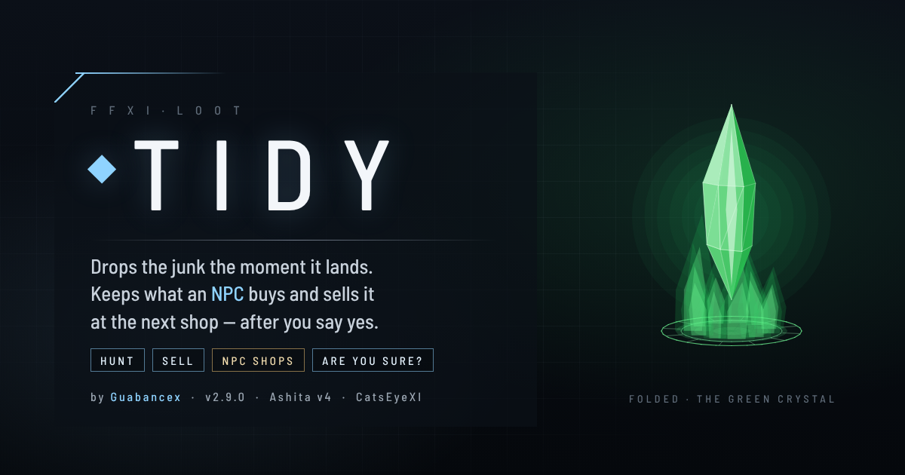
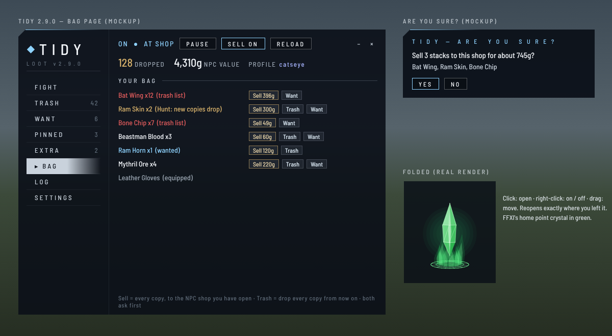

# Tidy

**Version:** 2.12.3 · **Author:** Guabancex · **For:** Ashita v4 · CatsEyeXI (FFXI)

Tidy keeps your bag clear while you play. Junk is dropped the moment it lands.
Anything an NPC buys can be kept instead and sold at the next shop you visit.
Tidy asks you first. It can also read the monster
you're fighting, look up its drop list in the CatsEyeXI database, and drop
everything from that list you don't need.



---

## Contents

- [What's new](#whats-new)
- [Features](#features)
- [Installing](#installing)
- [Quick start](#quick-start)
- [Selling to an NPC](#selling-to-an-npc)
- [Are you sure?](#are-you-sure)
- [The window](#the-window)
- [Commands](#commands)
- [How Tidy decides what to drop](#how-tidy-decides-what-to-drop)
- [Hunt mode in detail](#hunt-mode-in-detail)
- [Safety](#safety)
- [Troubleshooting](#troubleshooting)
- [Updating the drop database](#updating-the-drop-database)
- [Files](#files)

---

## What's new

- **2.12.3:** Lighter: the folded crystal makes about 75% less garbage per frame; dead code removed.
- **2.12.2:** Fixed: changing the UI size crashed Tidy; it now applies at once, no reload.
- **2.12.1:** Fixed: the UI size and window spots couldn't be saved on a fresh install (folder missing).
- **2.12.0:** **UI size slider** in Settings > Look: Auto (from your resolution) or 0.75x-3x; let go to apply.
- **2.11.3:** Fixed: the Bag page stopped at its first item (2.11.2).
- **2.11.2:** A **Trade** button beside every item on the **Bag** page and the trade list: trades just that
  item to the open player trade or the NPC you target (asks first).
- **2.11.1:** Trade **how many**: a count per trade-list item (buttons on the Want page, or
  `/tidy trade add 12 Fire Crystal`); 0 / All = every copy.
- **2.11.0:** **Trading.** A trade list per profile: kept, never dropped, and handed over when you trade, to a
  player (fills the open trade window) or to the NPC you target.
- **2.10.0:** **Farm goals** ("keep 12 Bone Chips"), a **Stats** page for the last 7 days, and **share a profile**
  as one line of text (Discord) with Import / Export.
- **2.9.1:** Sell mode offers every shop you open, not just the first one in a zone; lighter on the game in big fights.
- **2.9.0:** the auction house mode is removed. Tidy sells to NPC shops only.
- **2.7:** selling to NPCs works. Tidy now sends the appraisal and the sale
  together, the way the game does. Kept loot is counted, so it still sells
  after you zone into town. **Are you sure?** prompts appear before anything is
  sold or trashed.
- **2.7.1:** the folded crystal and the window each reopen exactly where you
  left them, after a restart too.

Every version is in [CHANGELOG.md](CHANGELOG.md).

---

## Features

- **Trash lists:** name the items you never want, and Tidy drops them on sight.
- **Hunt mode:** Tidy reads the mob you're fighting and drops the useless items
  from its drop list. There's no setup per mob.
- **Keep rules:** items marked **Want**, **Rare/Ex** items, and anything worth
  at least your **Keep value** are always kept.
- **Only new loot:** in Hunt mode, copies you already had are never touched.
- **Sell mode:** trash an NPC buys is kept and sold at the next shop you visit.
- **Are you sure?:** a Yes / No prompt comes up before Tidy sells or trashes
  anything.
- **Extra drops:** loot the server adds outside the drop lists (such as
  Ramuite) is learned from the treasure pool, and you choose Keep or Rules.
- **Profiles:** separate lists and hunts for each camp, job or event.
- **Treasure Hunter rates:** drop tables show each item's chance at your TH
  level, on CatsEyeXI's own scale.
- **4K-ready:** the size follows your game resolution. Change it with the
  **UI size** slider (Settings > Look) or `/tidy scale`.
- **`/tidy why`:** explains exactly why each item is or isn't dropped.
- **Farm goals:** "keep 12 Bone Chips". The item is kept until you hold that
  many (even if it's on your trash list), with a progress bar on the **Want**
  page. Tidy tells you once when you reach it; after that only *new* copies go,
  by your normal rules, so the 12 stay.
- **Stats:** the **Stats** page shows the last 7 days for this character: gil
  from sales, items dropped, gil per day, top sellers and most-dropped junk.
- **Trading:** put items on the **trade list** (Want page, or `/tidy trade add
  Fire Crystal`). They're never dropped. When a player opens a trade with you,
  Tidy asks *Put 2 stacks in the trade with Mule?* and fills the window (slots
  1-8) -- you still check it and press **Trade**. For an NPC, target it within 6
  yalms and press **Trade to my target** (or `/tidy trade`): after a Yes it hands
  over up to 8 stacks in one trade, just like the game's trade window.
  Each item has a **count** (the - / + box beside it; **All** = every copy), so
  you can hand over exactly 12 even when you hold 30.
  Every item on the **Bag** page (and on the trade list) also has its own
  **Trade** button: just that item, every copy (or its trade-list count).
- **Share a profile:** **Settings > Share** copies your trash list, want list,
  goals and keep rules as one line (`TIDY1;...`). Paste it on Discord; others
  paste it into **Import** (or `/tidy import`) and get it as a **new** profile,
  after a Yes / No. Only item ids travel; names come from their own game.

---

## Installing

1. Copy the `Tidy` folder into `Ashita/addons/`.
2. In game, type `/addon load tidy`.
3. To load it every time, add `/addon load tidy` to your Ashita startup script,
   for example `scripts/default.txt`.

The first time it loads, the window opens at screen position 600, 400. Tidy
saves its settings per character. The window's and the crystal's spots are
saved in `config/addons/tidy/window_pos.txt`.

The version shows in the window's sidebar, in the chat line when Tidy loads,
in `/tidy help`, and in the download's file name (`Tidy-v2.12.3.zip`).

---

## Quick start

**Drop specific junk**

1. Type `/tidy` to open the window.
2. On the **Bag** page, press **Trash** next to something you never want, then
   answer **Yes**. You can also type `/tidy add Bat Wing`.
3. Click **ON** at the top of the window, or type `/tidy on`.

**Let Tidy read your fights**

1. Type `/tidy on`. Hunt's **Auto** setting is on by default.
2. Engage a monster. The **Fight** page shows its drop table.
3. Press **Want** on the item you're farming. Everything else that mob drops is
   dropped as it lands, unless it's Rare/Ex or worth at least your Keep value.

**Sell instead of dropping**

1. Click **SELL OFF** in the header so it reads **SELL ON**, or type
   `/tidy sell on`.
2. Talk to any NPC vendor and answer **Yes**.

> **Tip:** try it on a cheap mob first. Dropped items are gone for good.

---

## Selling to an NPC

With **Sell mode** on, trash an NPC buys is **kept** instead of dropped. Trash
no NPC buys is still dropped.

When you open any NPC shop, Tidy asks **"Sell N stacks to this shop for about
Xg?"** and names the items. Click **Yes** and it sells them one stack at a
time, then reports the total in chat, for example `Sold 4 stacks for 312g`.
Click **No** and nothing is sold.

- **Sell buttons:** while a shop is open, **Sell Xg** next to an item on the
  Bag page (or **Sell xN** on the Trash page) sells every copy of it. It asks
  first.
- **What's sold:** every item on your trash list an NPC buys, plus the new loot
  Sell mode kept. Tidy counts that loot as it keeps it, so it still sells after
  you zone. Copies you already had are never sold, and neither is anything
  equipped, in your bazaar, or outside your main inventory.
- **Checked:** Tidy checks your bag after each sale. If a stack is still there,
  it says `The shop did not take <item>` and moves on.

---

## Are you sure?

A small **Yes / No** prompt comes up:

- before Tidy sells to a shop, and before a **Sell** button sells;
- before a **Trash** button puts an item on the trash list;
- before `/tidy drop`.

It shows even while Tidy is folded to the crystal. To turn it off, use the
**Ask before selling or trashing** switch on the Settings page or
`/tidy confirm off`. Automatic drops of loot, which is what Hunt and Auto are
for, never ask.

---

## The window

Tidy's look follows Final Fantasy XV's menus: smoked blue-black glass with the
top-left corner cut and lit in pale blue, a sidebar of pages, and the open page
on the right. Pale blue means on, kept or wanted. Muted red is what gets
dropped, soft gold is gil, and periwinkle marks places and extra drops.

**Header:**
- **ON / OFF** with a status (DROPPING, SELLING or AT SHOP).
- **PAUSE** stops dropping for this session only.
- **SELL ON / SELL OFF** switches Sell mode, and **RELOAD** reloads Tidy.
- **-** (fold) and **x** (close) sit in the corner.
- Below these are what Tidy has dropped this session, its NPC value, your
  profile, and the mob you're fighting.

**Folded:** click **-**, or type `/tidy mini`, to fold Tidy down to FFXI's home
point crystal in green. It turns over a glowing rune circle, and goes grey and
still while Tidy is off or paused.
- Click it to open the window.
- Right-click it to turn Tidy on or off.
- Drag it to move it.
- It reopens exactly where you left it, after a restart too.

**Lock** at the bottom of the sidebar pins the window and the crystal in place.
**Opacity** (30–100, Settings page or `/tidy opacity`) sets how much the game
shows through. Drag the bottom-right corner to resize the window.

| Page | What's on it |
|---|---|
| **Fight** | The mob you're fighting: its Treasure Hunter level and drop table, with each item's chance, NPC value, and what Tidy will do (DROP / WANT / VALUE / RARE / KEEP). **Want** / **Unwant** on any row. When you're not engaged, it previews the monster under your cursor, with a **Pin** button. |
| **Trash** | Your trash list (every copy is dropped). **Sell** sells them while a shop is open; **Keep** takes an item off the list. |
| **Want** | Items always kept, from every mob and Extra drop. |
| **Pinned** | Mobs whose drop lists are always cleaned in this profile. |
| **Extra** | Extra drops, each with **Use rules** / **Keep** and **Remove**. |
| **Bag** | Everything you carry, with **Sell**, **Trash** and **Want** buttons. |
| **Log** | Every drop and sale this session, with the time and value. |
| **Settings** | Profiles, Hunt rules, **Sell mode**, **Ask before selling or trashing**, Treasure Hunter, opacity, **Explain my bag** and **Reload**. |

To add an item, type part of its name (two letters or more) in a list's picker
and click the match. You don't need to have the item. Every list has a
**Search** box.

---

## Commands

| Command | What it does |
|---|---|
| `/tidy` | Show or hide the window |
| `/tidy on` · `/tidy off` | Start or stop dropping |
| `/tidy add <item>` · `/tidy remove <item>` · `/tidy list` | Trash list |
| `/tidy want <item>` | Toggle **Want** (always kept in Hunt) |
| `/tidy goal <count> <item>` · `/tidy goal` | Farm goal: keep that many (0 removes it) · list your goals |
| `/tidy stats` | Open the Stats page (last 7 days) |
| `/tidy trade` | Hand your trade list to the targeted NPC, or fill an open player trade (asks first) |
| `/tidy trade add [count\|all] <item>` · `/tidy trade remove <item>` · `/tidy trade list` | The trade list (kept, never dropped) |
| `/tidy trade count <count\|all> <item>` | How many of it to hand over (all = every copy) |
| `/tidy export` · `/tidy import [line]` | Copy this profile as one line · import one as a new profile (from the clipboard if no line) |
| `/tidy sell [on\|off]` | **Sell mode:** trash an NPC buys is kept and sold at the next shop |
| `/tidy confirm [on\|off]` | Ask Yes / No before selling or trashing (on by default) |
| `/tidy hunt` · `/tidy hunt clear` | Pin your target's drop list · unpin all |
| `/tidy hunt auto [on\|off]` | Read the mob you're fighting (default on) |
| `/tidy hunt value <gil>` | Keep anything worth at least this much NPC gil (0 = off) |
| `/tidy hunt forget` | Forget the mobs fought this session |
| `/tidy extra` · `/tidy extra add\|remove\|rules\|keep <item>` | Extra drops |
| `/tidy extra learn [on\|off]` | Learn Extra drops from the treasure pool (default on) |
| `/tidy profile [<name> \| new <name>]` | List, switch or create profiles |
| `/tidy th [auto \| 0-14]` | Treasure Hunter used for drop rates |
| `/tidy mini` | Fold to the crystal, or open again |
| `/tidy lock [on\|off]` | Lock the window and the crystal in place |
| `/tidy opacity <30-100>` | How solid the window is |
| `/tidy scale [auto \| 0.75-3]` | UI size (auto from your resolution: 1080p 1×, 1440p 1.25×, 4K 2×). Reloads Tidy to apply |
| `/tidy pause` · `/tidy reload` | Pause dropping this session · reload the addon |
| `/tidy why` | Explain every item in your bag |
| `/tidy drop <item>` | Drop one stack now (asks first) |
| `/tidy help` | Short command list |

Item names ignore case, so `bat wing` works.

---

## How Tidy decides what to drop

Tidy checks your main inventory about twice a second and drops one stack at a
time. The first rule that applies to an item decides what happens to it:

| # | Rule | Result |
|---|------|--------|
| 1 | Gil, equipped items, bazaar items | **Never dropped** |
| 2 | Marked **Want**, on the **trade list**, or a **farm goal** you haven't reached | **Kept** (a reached goal keeps its count; only new copies go) |
| 3 | On your **trash list** | **Dropped**, every copy (kept for the shop if Sell mode is on and an NPC buys it) |
| 4 | On the drop list of a mob you fought or pinned, and **Rare/Ex** | **Kept** |
| 5 | Same, and worth at least your **Keep value** | **Kept** |
| 6 | Same, and none of the above | **Dropped**, new copies only (kept for the shop in Sell mode) |
| – | An **Extra drop** set to Keep | **Kept** |
| 7 | Anything else | **Kept** |

Items that aren't on any list are always kept.

---

## Hunt mode in detail

- **The data:** `data/mobdb.lua` is built from the CatsEyeXI server SQL. It
  covers about 48,000 monsters and 2,900 drop lists, plus every item's NPC
  price and Rare/Ex flags.
- **Which mob:** while you're engaged, Tidy reads the monster you're
  attacking, so your cursor can be anywhere. Loot entering your treasure pool
  also tells Tidy which mob it came from, so adds and party kills count.
- **Only new loot:** when Tidy starts tracking an item, it remembers how many
  you already have. Only copies above that count are dropped.
- **Keep value is NPC price:** some materials sell cheaply to NPCs but well on
  the AH. Mark those **Want**.
- **Extra drops:** loot that isn't on any mob's list (Ramuite, for example) is
  learned as **Keep**. Set it to **Use rules** to let the keep rules decide.
- **Treasure Hunter:** drop tables show each item's chance per 100 kills at the
  mob's TH, on CatsEyeXI's own scale. The TH is:
  - **(est.)** worked out from your job, subjob, gear and party Thieves;
  - **(seen)** exact, as soon as a proc's action packet shows it;
  - **(set)** when you set it yourself with `/tidy th`.

  Treasure Hunter changes only the numbers shown, not what's dropped.

---

## Safety

- Off until you turn it on.
- Never drops gil, equipped items or bazaar items. Never sells them either,
  and never sells from outside your main inventory.
- Only drops items on your trash list, or on a known mob drop list, that fail
  every keep rule. Hunt never drops copies you already had.
- Asks before selling or trashing (`/tidy confirm`).
- Pauses while zoning, and drops one stack at a time.
- **Drops are permanent.** Unlike the game, Tidy doesn't ask before dropping a
  Rare/Ex item. Check your trash list before adding anything valuable.

---

## Troubleshooting

**Nothing is dropped.** Type `/tidy why`. It lists every item and what will
happen to it, and why.

| `/tidy why` says | Fix |
|---|---|
| `Tidy is OFF` | `/tidy on` |
| `you had N before -> kept` | Working as intended; new loot will drop |
| `kept: worth Ng+` | Lower your Keep value: `/tidy hunt value 100` |
| `kept: Rare/Ex` | Untick **Keep Rare/Ex** |
| `Engaged, but Tidy can't see your mob` | Put your cursor on the monster |
| `kept: Extra drop set to Keep` | `/tidy extra rules <item>` |

**Not selling.** Make sure **SELL ON** is set and the item is on your trash
list, or was looted in Hunt. Then open the vendor. If chat says
`The shop did not take <item>`, the shop refused it.

**`Could not load data/mobdb.lua`:** the `data` folder is missing. Reinstall
the whole `Tidy` folder.

---

## Updating the drop database

After changing drops on the server, rebuild the data file from the CatsEyeXI
SQL folder, then type `/addon reload tidy`:

```
python3 tools/build_db.py <path-to-catseyexi>/sql data/mobdb.lua
```

If the server's Treasure Hunter table changes, update `logic.TH_TABLE` in
`lib/logic.lua` to match `treasure_hunter.lua`.

---

## Files

```
Tidy/
├── tidy.lua            Addon: commands, window, drops, selling
├── lib/logic.lua       Rules, profiles, Hunt mode, packet builders
├── data/mobdb.lua      Mob drop database (generated)
├── fonts/              Barlow Semi Condensed (OFL)
├── images/             banner.png, preview.png (README images)
├── tools/build_db.py   Builds data/mobdb.lua from the server SQL
├── README.md           This file
├── CHANGELOG.md        Every version and what changed
└── LICENSE             MIT license
```

---

## License

Tidy is released under the [MIT License](LICENSE). You may use, copy, modify
and share it, as long as the copyright notice and license come with it. The
drop database is generated from CatsEyeXI server data, which keeps its own
license. Tidy comes with no warranty, and dropped items are gone for good.

*Tidy v2.12.3 by Guabancex.*
